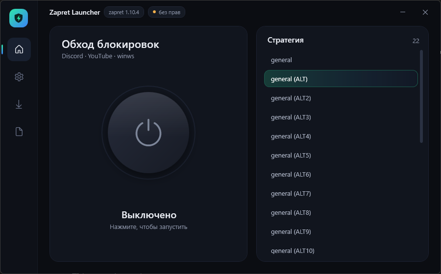

<div align="center">

# Zapret Launcher

**Неофициальный графический лаунчер для [zapret-discord-youtube](https://github.com/Flowseal/zapret-discord-youtube)**

Тёмный интерфейс, кнопка «вкл/выкл», автоподбор стратегии, трей, служба, обновления и прокси для Telegram.
Один exe на ~190 КБ, ничего ставить не нужно.

[](https://github.com/mahn1/zapret-launcher/releases/latest)


[](LICENSE)



</div>

> [!IMPORTANT]
> Это **не официальный** проект и не часть zapret. Лаунчер ничего не меняет в zapret и не распространяет его файлы:
> он запускает ваш экземпляр [zapret-discord-youtube](https://github.com/Flowseal/zapret-discord-youtube)
> (автор — Flowseal), в основе которого лежит [zapret](https://github.com/bol-van/zapret) (автор — bol-van).

## Содержание

- [Возможности](#возможности)
- [Установка](#установка)
- [Как пользоваться](#как-пользоваться)
- [Права администратора и UAC](#права-администратора-и-uac)
- [Безопасность и приватность](#безопасность-и-приватность)
- [Сборка из исходников](#сборка-из-исходников)
- [Как это устроено](#как-это-устроено)
- [Частые вопросы](#частые-вопросы)
- [Благодарности](#благодарности)
- [Лицензия](#лицензия)

## Возможности

**Обход**
- Список стратегий `general*.bat` и большая анимированная кнопка включения.
- winws.exe запускается без консольного окна, его вывод попадает во вкладку «Журнал». Если закрыть лаунчер, обход продолжит работать.
- Во время включения лаунчер проверяет связь с **YouTube** и **Discord**: показывает отклик в миллисекундах и повторяет проверку раз в 30 секунд.
- Таймер «в работе», обнуляется при выключении.
- **Подобрать стратегию**: лаунчер по очереди пробует все `general*.bat` и включает ту, с которой и YouTube, и Discord открываются быстрее всего.

**Фон и автозапуск**
- Работа из трея: значок цветной, когда обход включён, и серый, когда выключен. Меню: Открыть / Включить·Выключить / Выход.
- Автозапуск вместе с Windows сразу в трей, без запроса UAC при каждой загрузке.
- Автовключение обхода при запуске лаунчера.
- **Сторож**: если winws.exe упал, лаунчер перезапускает его, а если YouTube или Discord пропали, приходит предупреждение.

**Настройки zapret**
- Служба Windows: установка и удаление через **оригинальный** `service.bat`, статус и стратегия службы.
- **Свои сайты**: добавить домен в обход или в исключения, можно вставить ссылку целиком. Кириллические домены поддерживаются.
- Быстрые наборы: **Roblox — картинки** и **Photon — онлайн в играх** (вместе с Game Filter).
- Обновление zapret с GitHub: список изменений и установка по кнопке. Ваши списки и настройки сохраняются.

**Telegram**
- Поиск рабочих MTProto-прокси в открытых списках. Каждый прокси проверяется **настоящим рукопожатием**, а не просто пингом порта.
- Подключение в один клик: Telegram сам спрашивает подтверждение.

## Установка

1. Скачайте `ZapretLauncher.exe` со страницы [Releases](https://github.com/mahn1/zapret-launcher/releases/latest).
2. Положите его **в папку zapret-discord-youtube** (рядом с `service.bat`).
   Нет zapret? Запустите лаунчер где угодно и нажмите «Скачать последний релиз»: он скачает zapret с GitHub Flowseal в соседнюю папку.
3. Запустите, выберите стратегию и нажмите кнопку питания.

**Требования:** Windows 10 или 11 (x64). .NET Framework 4.8 уже встроен в систему, больше ничего не нужно.

> [!NOTE]
> exe не подписан цифровой подписью, поэтому при первом запуске Windows SmartScreen может показать
> «Windows защитила ваш компьютер». Нажмите «Подробнее» → «Выполнить в любом случае».
> Если не доверяете готовому файлу, [соберите лаунчер сами](#сборка-из-исходников) или сверьте SHA-256 со страницы релиза.

## Как пользоваться

| Вкладка | Что там |
|---|---|
| **Главная** | Кнопка вкл/выкл, проверка связи, таймер, список стратегий и кнопка «Подобрать» |
| **Служба** | Служба Windows, автозапуск, сторож, свои сайты и быстрые наборы |
| **Обновления** | Версия zapret, список изменений, обновление |
| **Telegram** | Поиск и подключение прокси |
| **Журнал** | Что делал лаунчер и что выводит winws |

- Двойной щелчок по стратегии включает её.
- «Свернуть» и «закрыть» убирают окно в трей. Выход — правой кнопкой по значку → «Выход».
- Если запустить exe ещё раз, откроется уже работающий лаунчер.
- Кнопка «Открыть меню service.bat» даёт доступ ко всем остальным настройкам zapret (IPSet, диагностика и т. д.).

**Если игра на Photon не подключается** даже после набора «Photon»: игровой UDP-трафик zapret обходит только для адресов из IPSet. Откройте меню `service.bat` и переключите **IPSet Filter** в `any`.

## Права администратора и UAC

Драйверу WinDivert, на котором работает winws, нужны права администратора. Лаунчер **запускается без них** и запрашивает их через стандартное окно UAC только для действий, которым они нужны (запуск или остановка обхода, служба, автозапуск). Обходов UAC нет.

Автозапуск создаёт задачу Планировщика `ZapretLauncher` с правами администратора. UAC вы подтверждаете один раз, при включении автозапуска. Задача удаляется переключателем; вручную её можно найти в «Планировщике заданий».

## Безопасность и приватность

- **Обновления zapret** скачиваются только по кнопке и только с `https://github.com/Flowseal/zapret-discord-youtube/releases/download/…`: адрес проверяется в коде. Пути внутри архива проверяются, поэтому файлы за пределы папки zapret не попадут.
- **Проверка версии** — при запуске один запрос к `api.github.com/repos/Flowseal/zapret-discord-youtube/releases/latest` (без загрузки файлов).
- **Проверка связи** — HTTPS-запросы к `www.youtube.com/generate_204` и `discord.com/api/v9/gateway`. Других обращений в сеть, кроме перечисленных здесь, нет.
- **Telegram-прокси** берутся из открытых списков на GitHub ([SoliSpirit/mtproto](https://github.com/SoliSpirit/mtproto), [ALIILAPRO/MTProtoProxy](https://github.com/ALIILAPRO/MTProtoProxy)). Переписка в Telegram остаётся зашифрованной самим Telegram, владелец прокси видит только ваш IP. Прокси добавляются **только** после вашего подтверждения в самом Telegram.
- Лаунчер не собирает статистику и ничего никуда не отправляет.
- Где лежат данные лаунчера:
  - настройки (папка zapret, стратегия, переключатели) — `%APPDATA%\ZapretLauncher\settings.ini`;
  - вывод winws — `%TEMP%\ZapretLauncher\winws.log`.

## Сборка из исходников

Visual Studio и .NET SDK не нужны: собирается компилятором `csc.exe`, который входит в Windows.

```bat
git clone https://github.com/mahn1/zapret-launcher.git
cd zapret-launcher
build.bat
```

Результат: `dist\ZapretLauncher.exe`. Иконку можно перерисовать скриптом `python tools\make_icon.py` (нужен Pillow).

## Как это устроено

```
src/Program.cs        интерфейс, анимации, сценарии (запуск, подбор, служба, обновление, сторож, свои сайты)
src/Zapret.cs         работа с zapret: стратегии, winws, service.bat, GitHub API, распаковка
src/Telegram.cs       поиск и проверка MTProto-прокси (fake-TLS и obfuscated2)
src/Autostart.cs      задача Планировщика для автозапуска
src/Tray.cs           значок и меню в трее
src/MainWindow.xaml   разметка и стили (тёмная тема)
build.bat             сборка
```

- **Логику zapret лаунчер не переписывает.** Аргументы winws он берёт из выбранного `general*.bat`. Переменные (`%BIN%`, `%LISTS%`, Game Filter) подставляет сам `service.bat` через команды `load_game_filter` и `load_user_lists`. Службу ставит и удаляет оригинальное меню `service.bat`: лаунчер отвечает на его вопросы.
- **Почему WPF на .NET Framework 4.8:** он уже есть в каждой Windows 10/11, рисует через GPU, а вся программа помещается в один exe примерно на 190 КБ и открывается меньше чем за секунду. Для сравнения: Tauri дал бы 3–10 МБ, PySide6 — 40–80 МБ, Electron — 100+ МБ.

## Частые вопросы

<details>
<summary><b>Антивирус ругается на winws.exe / WinDivert</b></summary>

Это особенность самого zapret: WinDivert — драйвер перехвата пакетов, и некоторые антивирусы помечают его как «потенциально нежелательное ПО». Подробнее — в [README zapret-discord-youtube](https://github.com/Flowseal/zapret-discord-youtube). Сам лаунчер не содержит ни winws, ни WinDivert.
</details>

<details>
<summary><b>Ничего не открывается ни с одной стратегией</b></summary>

Нажмите «Подобрать». Если не помогло: проверьте, не включены ли VPN или системный прокси, и запустите «Диагностику» в меню `service.bat`. Бывает, что мешает другой обходчик (GoodbyeDPI, другой zapret).
</details>

<details>
<summary><b>Служба или ручной запуск — что выбрать?</b></summary>

Служба работает без лаунчера и поднимается раньше входа в систему. Автозапуск лаунчера даёт трей, сторож и проверку связи. Одновременно их не включайте: лаунчер предупредит, если служба уже работает.
</details>

<details>
<summary><b>Почему прокси нельзя добавить в Telegram без подтверждения?</b></summary>

Так задумано в самом Telegram: никакая программа не может тихо пустить ваш трафик через чужой сервер. Править зашифрованную папку `tdata` напрямую небезопасно, поэтому лаунчер этого не делает.
</details>

## Благодарности

- [bol-van/zapret](https://github.com/bol-van/zapret) — сам инструмент обхода DPI (winws).
- [Flowseal/zapret-discord-youtube](https://github.com/Flowseal/zapret-discord-youtube) — готовые стратегии и `service.bat`.
- [basil00/WinDivert](https://github.com/basil00/WinDivert) — драйвер перехвата пакетов.
- Авторы открытых списков MTProto-прокси.

## Лицензия

[MIT](LICENSE) — только для кода лаунчера. У zapret, zapret-discord-youtube и WinDivert свои лицензии, смотрите их репозитории.

Проект создан для доступа к информации и сервисам. Вы сами отвечаете за то, как используете его, с учётом законов вашей страны.
